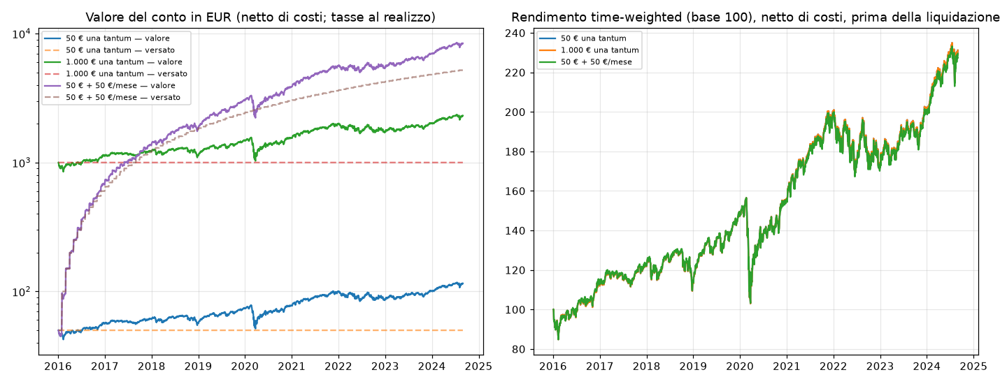

# Benchmark — piano di accumulo su ETF azionario globale

- **Generato il:** 2026-11-07 · **codice:** `66313b4f77e7`
- **Periodo:** 2016-01-04 → 2024-08-30 (periodo di ricerca)
- **Hold-out:** dal 2024-09-02 — **non usato** (si apre una sola volta al Gate 0)
- **Dati:** snapshot `7e30828b2ec3eb20` · **famiglia G-12:** `benchmark`

> Risultati simulati su dati storici: **non sono una previsione** né una promessa di rendimento. I numeri fiscali sono stime del motore e vanno verificati da un commercialista.

## In breve

- Il piano di accumulo sull'ETF globale ha reso **8,0% l'anno netto** in 8,7 anni (2016-01-04 → 2024-08-30), con un drawdown massimo di **-34,2%** e Sharpe **0,48**.
- 50 € investiti sarebbero diventati **97,43 €** dopo costi e tasse (liquidando tutto alla fine). Il rendimento è quello del mercato azionario globale in un periodo favorevole: non è un'aspettativa per il futuro.
- **Il benchmark stesso non supera le soglie del Gate 0** (Sharpe > 1, drawdown < 15%): sono soglie molto severe, che un indice azionario non rispetta. Una strategia che le supera deve battere il mercato con meno della metà del suo rischio: è raro, e un risultato del genere va guardato con sospetto.
- Con 50 € i costi del piano di accumulo sono quasi nulli (0 € di commissione); un ordine singolo da 1 € su 50 € costerebbe il 2% e verrebbe bloccato da G-05. Raddoppiare spread e commissioni cambia pochissimo: per il benchmark contano le tasse, non i costi.
- Il soft stop (G-01, −15% dal massimo) è scattato 4 volte (2016, 2018, 2020, 2022). Con i versamenti mensili ha bloccato 3 acquisti durante i crolli, proprio quando comprare conveniva: è il prezzo della prudenza, da valutare prima del paper trading.

## Scenari

| | 50 € una tantum | 1.000 € una tantum | 50 € + 50 €/mese |
|---|---|---|---|
| Versato | 50,00 € | 1.000,00 € | 5.200,00 € |
| Valore finale (tasse latenti non pagate) | 115,60 € | 2.312,05 € | 8.406,77 € |
| **Valore se liquidato** (costi e tasse inclusi) | **97,43 €** | **1.962,49 €** | **7.553,42 €** |
| **CAGR netto** (time-weighted, liquidazione inclusa) | **8,0%** | **8,1%** | **8,7%** |
| CAGR prima delle tasse latenti | 10,2% | 10,2% | 10,1% |
| Volatilità annua | 19,0% | 18,9% | 18,4% |
| Sharpe netto (rf = €STR) | 0,48 | 0,49 | 0,53 |
| Sortino | 0,65 | 0,66 | 0,73 |
| Max drawdown | -34,2% | -34,2% | -34,1% |
| Calmar | 0,23 | 0,24 | 0,26 |
| Commissioni + spread | 0,02 € | 0,50 € | 2,57 € |
| Imposte trattenute + bollo | 1,31 € | 26,23 € | 60,53 € |
| Imposte alla liquidazione finale | 17,12 € | 347,39 € | 848,14 € |
| Ordini eseguiti | 1 | 1 | 104 |
| Ordini rifiutati (codice) | G-10×1 | G-10×1 | G-10×47, G-01×3 |
| Eventi di rischio (G-01/G-02) | 8 | 8 | 2 |
| PSR (prob. Sharpe > 0) | 91,8% | 92,0% | 93,7% |
| Esperimento G-12 | #9 | #11 | #13 |

## Sensibilità ai costi (commissioni e spread × 2)

| Scenario | CAGR ×1 | CAGR ×2 | Liquidato ×1 | Liquidato ×2 |
|---|---|---|---|---|
| 50 € una tantum | 8,0% | 7,9% | 97,43 € | 96,60 € |
| 1.000 € una tantum | 8,1% | 8,1% | 1.962,49 € | 1.960,04 € |
| 50 € + 50 €/mese | 8,7% | 8,7% | 7.553,42 € | 7.546,52 € |

## Anno per anno — 50 € una tantum

Rendimenti al netto di costi, bollo e imposte già pagate; le imposte sulle plusvalenze non ancora 
realizzate sono escluse (sono nel CAGR netto qui sopra).

| Anno | Rendimento | Max drawdown |
|---|---|---|
| 2016 | 11,9% | -15,2% |
| 2017 | 8,8% | -6,9% |
| 2018 | -6,1% | -16,2% |
| 2019 | 28,6% | -7,2% |
| 2020 | 6,2% | -34,2% |
| 2021 | 27,6% | -5,1% |
| 2022 | -13,5% | -16,5% |
| 2023 | 17,3% | -7,3% |
| 2024 | 14,4% | -8,8% |

## Confronto con le soglie del Gate 0 — 50 € una tantum

| Metrica | Soglia | Valore | Esito |
|---|---|---|---|
| Sharpe netto | > 1,0 | 0,48 | ❌ |
| Max drawdown | < 15% | -34,2% | ❌ |
| Rendimento netto vs benchmark | > 0 | 0,0% | ❌ |
| Deflated Sharpe Ratio | > 95% | 90,3% | ❌ |
| Numero di trade | ≥ 30 | 1 | ❌ |
| PBO | < 0,5 | n/d (una sola configurazione) | — |

## Eventi di rischio

- 2016-02-11: `{'SoftStopTriggered': {'equity_eur': 42.40071496502899, 'drawdown_pct': 15.198570069942019}}`
- 2016-03-10: `{'Resumed': {'new_high_water_mark_eur': 48.57242444816152}}`
- 2018-12-24: `{'SoftStopTriggered': {'equity_eur': 54.65459353929904, 'drawdown_pct': 16.186070362225546}}`
- 2019-01-23: `{'Resumed': {'new_high_water_mark_eur': 60.480856413898174}}`
- 2020-03-06: `{'SoftStopTriggered': {'equity_eur': 65.96051176163131, 'drawdown_pct': 15.743907619805631}}`
- 2020-04-02: `{'Resumed': {'new_high_water_mark_eur': 57.29162430897052}}`
- 2022-06-16: `{'SoftStopTriggered': {'equity_eur': 84.54329127661632, 'drawdown_pct': 15.897282319143514}}`
- 2022-07-15: `{'Resumed': {'new_high_water_mark_eur': 89.73028369211296}}`

## Ipotesi del modello

- Prezzi: proxy USA `all_world` rettificato per dividendi (come un ETF ad accumulo), convertito in EUR con il cambio BCE e ridotto di 40 bp/anno per ritenuta sui dividendi e TER dell'UCITS reale (stima).
- Decisione alle 9:00 (Roma) con i soli dati pubblicati prima (G-11); esecuzione all'apertura dello stesso giorno con metà spread stimato (10 bp per gli ETF) e 0 € di commissione (piano di accumulo).
- Guardrails, costi, ledger e fisco: stesso codice `money-core` del paper/live. G-10 (dati vecchi > 36 h) blocca gli ordini del lunedì e dopo i festivi USA: l'ordine si riprova il giorno dopo.
- Tasse: 26% al realizzo (ETF = redditi di capitale); bollo 0,2% annuo addebitato a fine anno sul valore giornaliero. 🟡 Se esistesse un **minimo di 1 €/anno** (da verificare, knowledge/fisco/08) su 50 € il bollo salirebbe al 2% l'anno.
- Il bollo è addebitato sulla liquidità anche se è tutta investita: la cassa può scendere di pochi centesimi sotto zero (in realtà il broker la compenserebbe).
- Valore 'se liquidato': vendita di tutto alla chiusura dell'ultimo giorno con 1 € di commissione e imposta del 26% sulla plusvalenza. Il CAGR netto include questa liquidazione.
- Soft stop (G-01): nel backtest la ripartenza avviene dopo 20 giorni di borsa.
- Rendimenti time-weighted (i versamenti non sono rendimento); Sharpe con €STR (EONIA − 8,5 bp prima dell'ottobre 2019).

## Registro dei tentativi (G-12)

- #9 50 € una tantum, costi ×1
- #10 50 € una tantum, costi ×2
- #11 1.000 € una tantum, costi ×1
- #12 1.000 € una tantum, costi ×2
- #13 50 € + 50 €/mese, costi ×1
- #14 50 € + 50 €/mese, costi ×2

---

Risultati simulati su dati storici: **non sono una previsione** né una promessa di rendimento. I numeri fiscali sono stime del motore e vanno verificati da un commercialista.
