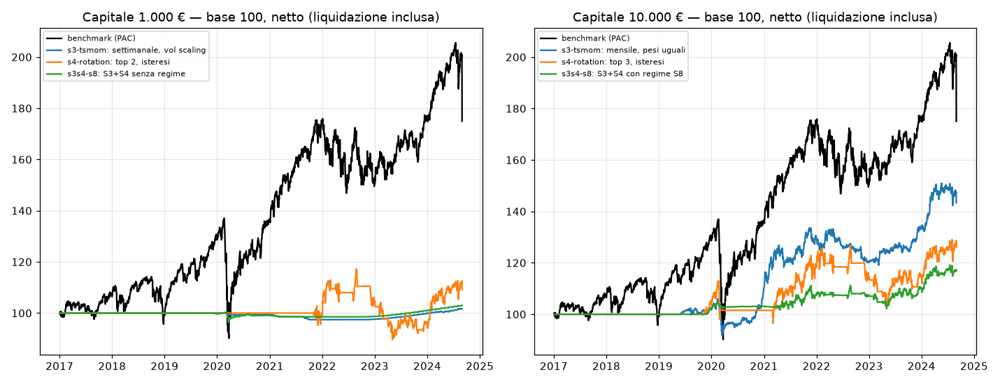

# M4 — Strategie su ETF: trend (S3), rotazione (S4), regime (S8)

- **Generato il:** 2026-11-07 · **codice:** `881bbc5c18d3`
- **Periodo:** 2017-01-03 → 2024-08-30 (periodo di ricerca, in-sample)
- **Hold-out:** dal 2024-09-02 — **non usato** · **dati:** `835e2610b2e2892e`

> Risultati simulati su dati storici: **non sono una previsione** né una promessa di rendimento. I numeri fiscali sono stime del motore e vanno verificati da un commercialista.

## In breve

- **1.000 €** — benchmark: CAGR netto 7,6%, Sharpe 0,46, drawdown -34,2%.
  - S3 — Trend following multi-asset (TSMOM): **troppo pochi ordini per una statistica affidabile** (al massimo 15 in 8 anni, ne servono 30): i guardrails G-05/G-06 bloccano ordini troppo piccoli rispetto ai costi. Variante più attiva: settimanale, vol scaling, CAGR 0,2% contro 7,6% del benchmark.
  - S4 — Rotazione momentum sui settori (migliore: top 2, isteresi): CAGR 1,2%, Sharpe 0,12, drawdown -23,5%, 30 ordini — **non batte** il benchmark (-6,4%/anno).
  - S3 + S4 con il regime S8: **troppo pochi ordini per una statistica affidabile** (al massimo 5 in 8 anni, ne servono 30): i guardrails G-05/G-06 bloccano ordini troppo piccoli rispetto ai costi. Variante più attiva: S3+S4 senza regime, CAGR 0,4% contro 7,6% del benchmark.
- **10.000 €** — benchmark: CAGR netto 7,6%, Sharpe 0,46, drawdown -34,2%.
  - S3 — Trend following multi-asset (TSMOM) (migliore: mensile, pesi uguali): CAGR 4,8%, Sharpe 0,60, drawdown -13,5%, 227 ordini — **non batte** il benchmark (-2,8%/anno).
  - S4 — Rotazione momentum sui settori (migliore: top 3, isteresi): CAGR 3,1%, Sharpe 0,30, drawdown -19,2%, 96 ordini — **non batte** il benchmark (-4,5%/anno).
  - S3 + S4 con il regime S8 (migliore: S3+S4 con regime S8): CAGR 2,0%, Sharpe 0,35, drawdown -8,2%, 184 ordini — **non batte** il benchmark (-5,5%/anno).
- **50 €** — benchmark: CAGR netto 7,5%, Sharpe 0,45, drawdown -34,2%.
  - S3 — Trend following multi-asset (TSMOM): **troppo pochi ordini per una statistica affidabile** (al massimo 0 in 8 anni, ne servono 30): la strategia opera raramente per costruzione. Variante più attiva: mensile, vol scaling, CAGR 0,6% contro 7,5% del benchmark.
  - S4 — Rotazione momentum sui settori: **troppo pochi ordini per una statistica affidabile** (al massimo 0 in 8 anni, ne servono 30): la strategia opera raramente per costruzione. Variante più attiva: top 3, isteresi, CAGR 0,6% contro 7,5% del benchmark.
  - S3 + S4 con il regime S8: **troppo pochi ordini per una statistica affidabile** (al massimo 0 in 8 anni, ne servono 30): la strategia opera raramente per costruzione. Variante più attiva: S3+S4 con regime S8, CAGR 0,6% contro 7,5% del benchmark.
- **Gate 0 (in-sample):** nessuna variante supera tutte le soglie.

## S3 — Trend following multi-asset (TSMOM)

| Variante | Capitale | Liquidato | CAGR netto | vs benchmark | Sharpe | Max DD | Ordini | Rifiuti principali | Interessi | DSR | PBO |
|---|---|---|---|---|---|---|---|---|---|---|---|
| mensile, vol scaling | 1.000 € | 1.028,65 € | 0,4% | -7,2% | -0,11 | -1,3% | 7 | G-06×648, G-10×141, MERCATO×38 | 55,44 € | 13,6% | 0,06 |
| mensile, pesi uguali | 1.000 € | 1.045,97 € | 0,6% | -7,0% | 0,45 | 0,0% | 0 | G-06×869, G-10×171, MERCATO×46 | 62,11 € | 63,1% | 0,06 |
| settimanale, vol scaling | 1.000 € | 1.016,53 € | 0,2% | -7,4% | -0,42 | -3,0% | 15 | G-06×2985, G-10×627, MERCATO×105 | 57,48 € | 1,7% | 0,06 |
| settimanale, pesi uguali | 1.000 € | 1.045,97 € | 0,6% | -7,0% | 0,45 | 0,0% | 0 | G-06×3875, G-10×733, MERCATO×124 | 62,11 € | 49,1% | 0,06 |
| mensile, vol scaling | 10.000 € | 11.358,64 € | 1,7% | -5,9% | 0,40 | -6,9% | 160 | G-06×564, G-10×170, MERCATO×45 | 345,67 € | 43,5% | 0,74 |
| mensile, pesi uguali | 10.000 € | 14.335,86 € | 4,8% | -2,8% | 0,60 | -13,5% | 227 | G-06×375, G-10×157, MERCATO×32 | 307,07 € | 65,3% | 0,74 |
| settimanale, vol scaling | 10.000 € | 11.027,91 € | 1,3% | -6,3% | 0,31 | -6,2% | 405 | G-06×3182, G-10×893, MERCATO×134 | 338,57 € | 34,3% | 0,74 |
| settimanale, pesi uguali | 10.000 € | 13.176,83 € | 3,7% | -3,9% | 0,48 | -12,4% | 561 | G-06×2049, G-10×799, MERCATO×90 | 271,56 € | 53,4% | 0,74 |
| mensile, vol scaling | 50 € | 52,32 € | 0,6% | -6,9% | 0,46 | 0,0% | 0 | — | 3,10 € | 51,7% | n/d |
| mensile, pesi uguali | 50 € | 52,32 € | 0,6% | -6,9% | 0,46 | 0,0% | 0 | — | 3,10 € | 52,1% | n/d |
| settimanale, vol scaling | 50 € | 52,32 € | 0,6% | -6,9% | 0,46 | 0,0% | 0 | — | 3,10 € | 52,4% | n/d |
| settimanale, pesi uguali | 50 € | 52,32 € | 0,6% | -6,9% | 0,46 | 0,0% | 0 | — | 3,10 € | 52,8% | n/d |

## S4 — Rotazione momentum sui settori

| Variante | Capitale | Liquidato | CAGR netto | vs benchmark | Sharpe | Max DD | Ordini | Rifiuti principali | Interessi | DSR | PBO |
|---|---|---|---|---|---|---|---|---|---|---|---|
| top 3, isteresi | 1.000 € | 1.107,01 € | 1,3% | -6,2% | 0,33 | -6,6% | 5 | G-06×594, G-10×128, MERCATO×36 | 49,20 € | 54,8% | 0,06 |
| top 3, senza isteresi | 1.000 € | 1.069,61 € | 0,9% | -6,7% | 0,15 | -9,7% | 7 | G-06×594, G-10×130, MERCATO×36 | 49,22 € | 36,6% | 0,06 |
| top 2, isteresi | 1.000 € | 1.091,61 € | 1,2% | -6,4% | 0,12 | -23,5% | 30 | G-06×232, G-10×62, MERCATO×20 | 9,56 € | 32,9% | 0,06 |
| top 2, senza isteresi | 1.000 € | 1.049,28 € | 0,6% | -7,0% | 0,07 | -23,5% | 38 | G-06×232, G-10×66, MERCATO×22 | 9,95 € | 27,3% | 0,06 |
| top 3, isteresi | 10.000 € | 12.604,18 € | 3,1% | -4,5% | 0,30 | -19,2% | 96 | G-06×247, G-10×87, MERCATO×25 | 114,34 € | 50,8% | 0,63 |
| top 3, senza isteresi | 10.000 € | 11.922,64 € | 2,3% | -5,3% | 0,23 | -19,2% | 112 | G-06×226, G-10×87, MERCATO×24 | 109,88 € | 43,1% | 0,63 |
| top 2, isteresi | 10.000 € | 11.804,11 € | 2,2% | -5,4% | 0,21 | -22,8% | 71 | G-06×187, G-10×66, MERCATO×21 | 106,34 € | 41,0% | 0,63 |
| top 2, senza isteresi | 10.000 € | 12.397,32 € | 2,8% | -4,7% | 0,25 | -22,7% | 90 | G-06×148, G-10×68, MERCATO×22 | 116,17 € | 45,7% | 0,63 |
| top 3, isteresi | 50 € | 52,32 € | 0,6% | -6,9% | 0,46 | 0,0% | 0 | — | 3,10 € | 71,1% | n/d |
| top 3, senza isteresi | 50 € | 52,32 € | 0,6% | -6,9% | 0,46 | 0,0% | 0 | — | 3,10 € | 70,5% | n/d |
| top 2, isteresi | 50 € | 52,32 € | 0,6% | -6,9% | 0,46 | 0,0% | 0 | — | 3,10 € | 69,9% | n/d |
| top 2, senza isteresi | 50 € | 52,32 € | 0,6% | -6,9% | 0,46 | 0,0% | 0 | — | 3,10 € | 69,5% | n/d |

## S3 + S4 con il regime S8

| Variante | Capitale | Liquidato | CAGR netto | vs benchmark | Sharpe | Max DD | Ordini | Rifiuti principali | Interessi | DSR | PBO |
|---|---|---|---|---|---|---|---|---|---|---|---|
| S3+S4 con regime S8 | 1.000 € | 1.045,97 € | 0,6% | -7,0% | 0,45 | 0,0% | 0 | G-06×681, G-10×144, MERCATO×39 | 62,11 € | 82,5% | 0,03 |
| S3+S4 senza regime | 1.000 € | 1.030,52 € | 0,4% | -7,2% | -0,03 | -4,1% | 5 | G-06×661, G-10×142, MERCATO×39 | 61,19 € | 30,3% | 0,03 |
| S3+S4 con regime S8 | 10.000 € | 11.676,49 € | 2,0% | -5,5% | 0,35 | -8,2% | 184 | G-06×519, G-10×159, MERCATO×41 | 266,78 € | 60,3% | 0,71 |
| S3+S4 senza regime | 10.000 € | 11.543,41 € | 1,9% | -5,7% | 0,27 | -9,5% | 190 | G-06×586, G-10×176, MERCATO×49 | 207,74 € | 52,5% | 0,71 |
| S3+S4 con regime S8 | 50 € | 52,32 € | 0,6% | -6,9% | 0,46 | 0,0% | 0 | — | 3,10 € | 75,2% | n/d |
| S3+S4 senza regime | 50 € | 52,32 € | 0,6% | -6,9% | 0,46 | 0,0% | 0 | — | 3,10 € | 75,2% | n/d |

## Gate 0 in-sample — migliore variante per famiglia (1.000 €)

Indicativo: il Gate 0 vero si misura **una volta sola** sull'hold-out.

**S3 — Trend following multi-asset (TSMOM) — settimanale, vol scaling**

| Metrica | Soglia | Valore | Esito |
|---|---|---|---|
| Sharpe netto | > 1,0 | -0,42 | ❌ |
| Max drawdown | < 15% | -3,0% | ✅ |
| Rendimento netto vs benchmark | > 0 | -7,4% | ❌ |
| Deflated Sharpe Ratio | > 95% | 1,7% | ❌ |
| Numero di trade | ≥ 30 | 15 | ❌ |
| PBO | < 0,5 | 0,06 | ✅ |

**S4 — Rotazione momentum sui settori — top 2, isteresi**

| Metrica | Soglia | Valore | Esito |
|---|---|---|---|
| Sharpe netto | > 1,0 | 0,12 | ❌ |
| Max drawdown | < 15% | -23,5% | ❌ |
| Rendimento netto vs benchmark | > 0 | -6,4% | ❌ |
| Deflated Sharpe Ratio | > 95% | 32,9% | ❌ |
| Numero di trade | ≥ 30 | 30 | ✅ |
| PBO | < 0,5 | 0,06 | ✅ |

**S3 + S4 con il regime S8 — S3+S4 senza regime**

| Metrica | Soglia | Valore | Esito |
|---|---|---|---|
| Sharpe netto | > 1,0 | -0,03 | ❌ |
| Max drawdown | < 15% | -4,1% | ✅ |
| Rendimento netto vs benchmark | > 0 | -7,2% | ❌ |
| Deflated Sharpe Ratio | > 95% | 30,3% | ❌ |
| Numero di trade | ≥ 30 | 5 | ❌ |
| PBO | < 0,5 | 0,03 | ✅ |

## Diagnostica a 10.000 €

Con più capitale gli ordini sono più grandi, le commissioni fisse pesano meno e G-05/G-06 bloccano meno: questa colonna dice se la **strategia in sé** ha valore, al netto del vincolo dei 50 €.

## Ipotesi del modello

- Periodo di ricerca dal primo giorno di borsa del 2017 (il 2016 serve come storia per i segnali a 12 mesi) fino all'inizio dell'hold-out, che resta intatto. Benchmark sullo stesso periodo.
- Proxy USA rettificati in EUR con drag annuo stimato; obbligazioni globali trattate come coperte in EUR (nessuna conversione) con 160 bp/anno di costo di copertura stimato (`config/validation.toml`).
- Decisione alle 9:00 con i soli dati pubblicati (G-11); controllo dei guardrails con il prezzo noto alla decisione; esecuzione all'apertura con metà spread e 1 € di commissione (ordini normali).
- `expected_edge_pct` (G-06): rendimento medio realizzato a 63 giorni per livello di segnale, stimato solo sul passato e **dimezzato**. Finché ci sono meno di 24 osservazioni la strategia non compra.
- Banda di non-trading 50 € (G-05 con 1 € di commissione), cuscinetto di liquidità 1%, massimo 3 ordini al giorno (G-07); i pesi si inseguono per 5 giorni di borsa dopo il ribilanciamento.
- Interessi sulla liquidità al tasso €STR quando positivo, tassati al 26%; bollo 0,2% annuo; imposte al realizzo trattenute come farebbe il broker; liquidazione finale inclusa nel CAGR netto.
- Sharpe con rf = €STR: tra il 2016 e il 2022 l'€STR era negativo, quindi una variante che resta in liquidità ha uno Sharpe (e un DSR) positivo senza fare nulla. Per questo la 'migliore variante' si sceglie solo tra quelle con almeno 30 ordini.
- PBO 'n/d': le varianti della famiglia hanno rendimenti praticamente identici (es. tutte ferme in liquidità), quindi la probabilità di overfitting non è definita.

## Registro dei tentativi (G-12)

- #110 benchmark: benchmark, 1000 €
- #111 benchmark: benchmark, 10000 €
- #112 benchmark: benchmark, 50 €
- #113 s3-tsmom: mensile, vol scaling, 1000 €
- #114 s3-tsmom: mensile, pesi uguali, 1000 €
- #115 s3-tsmom: settimanale, vol scaling, 1000 €
- #116 s3-tsmom: settimanale, pesi uguali, 1000 €
- #117 s3-tsmom: mensile, vol scaling, 10000 €
- #118 s3-tsmom: mensile, pesi uguali, 10000 €
- #119 s3-tsmom: settimanale, vol scaling, 10000 €
- #120 s3-tsmom: settimanale, pesi uguali, 10000 €
- #121 s3-tsmom: mensile, vol scaling, 50 €
- #122 s3-tsmom: mensile, pesi uguali, 50 €
- #123 s3-tsmom: settimanale, vol scaling, 50 €
- #124 s3-tsmom: settimanale, pesi uguali, 50 €
- #125 s4-rotation: top 3, isteresi, 1000 €
- #126 s4-rotation: top 3, senza isteresi, 1000 €
- #127 s4-rotation: top 2, isteresi, 1000 €
- #128 s4-rotation: top 2, senza isteresi, 1000 €
- #129 s4-rotation: top 3, isteresi, 10000 €
- #130 s4-rotation: top 3, senza isteresi, 10000 €
- #131 s4-rotation: top 2, isteresi, 10000 €
- #132 s4-rotation: top 2, senza isteresi, 10000 €
- #133 s4-rotation: top 3, isteresi, 50 €
- #134 s4-rotation: top 3, senza isteresi, 50 €
- #135 s4-rotation: top 2, isteresi, 50 €
- #136 s4-rotation: top 2, senza isteresi, 50 €
- #137 s3s4-s8: S3+S4 con regime S8, 1000 €
- #138 s3s4-s8: S3+S4 senza regime, 1000 €
- #139 s3s4-s8: S3+S4 con regime S8, 10000 €
- #140 s3s4-s8: S3+S4 senza regime, 10000 €
- #141 s3s4-s8: S3+S4 con regime S8, 50 €
- #142 s3s4-s8: S3+S4 senza regime, 50 €

---

Risultati simulati su dati storici: **non sono una previsione** né una promessa di rendimento. I numeri fiscali sono stime del motore e vanno verificati da un commercialista.
