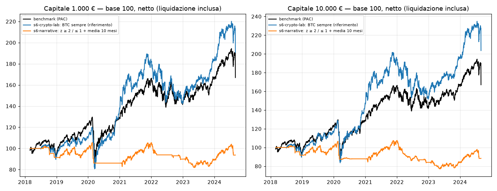

# M8 — Sentiment (S6): laboratorio crypto e narrazione di crisi

- **Generato il:** 2026-11-07 · **codice:** `881bbc5c18d3-dirty`
- **Periodo:** 2018-03-01 → 2024-08-30 (periodo di ricerca, in-sample)
- **Hold-out:** dal 2024-09-02 — **non usato** · **dati:** `f7e2f7cfafa9dc79`

> Risultati simulati su dati storici: **non sono una previsione** né una promessa di rendimento. I numeri fiscali sono stime del motore e vanno verificati da un commercialista.

## In breve

- **1.000 €** — benchmark: CAGR netto 8,2%, Sharpe 0,47, drawdown -34,1%.
  - Laboratorio crypto — core + bitcoin temporizzato col Fear & Greed: **troppo pochi ordini per una statistica affidabile** (al massimo 19 in 6 anni, ne servono 30): i guardrails G-05/G-06 bloccano ordini troppo piccoli rispetto ai costi. Variante più attiva: BTC sempre (riferimento), CAGR 10,5% contro 8,2% del benchmark.
  - Narrazione di crisi (GDELT) — ETF globale con uscita sulle obbligazioni (migliore: z ≥ 2 / ≤ 1 + media 10 mesi): CAGR -1,0%, Sharpe -0,10, drawdown -22,4%, 50 ordini — **non batte** il benchmark (-9,2%/anno).
- **10.000 €** — benchmark: CAGR netto 8,2%, Sharpe 0,47, drawdown -34,1%.
  - Laboratorio crypto — core + bitcoin temporizzato col Fear & Greed: **troppo pochi ordini per una statistica affidabile** (al massimo 23 in 6 anni, ne servono 30): la strategia opera raramente per costruzione. Variante più attiva: BTC sempre (riferimento), CAGR 11,6% contro 8,2% del benchmark.
  - Narrazione di crisi (GDELT) — ETF globale con uscita sulle obbligazioni (migliore: z ≥ 2 / ≤ 1 + media 10 mesi): CAGR -1,9%, Sharpe -0,18, drawdown -28,3%, 66 ordini — **non batte** il benchmark (-10,1%/anno).
- **50 €** — benchmark: CAGR netto 8,1%, Sharpe 0,46, drawdown -34,1%.
  - Laboratorio crypto — core + bitcoin temporizzato col Fear & Greed: **troppo pochi ordini per una statistica affidabile** (al massimo 1 in 6 anni, ne servono 30): la strategia opera raramente per costruzione. Variante più attiva: BTC sempre (riferimento), CAGR 6,6% contro 8,1% del benchmark.
  - Narrazione di crisi (GDELT) — ETF globale con uscita sulle obbligazioni (migliore: z ≥ 2 / ≤ 1 + media 10 mesi): CAGR -8,1%, Sharpe -0,74, drawdown -48,8%, 44 ordini — **non batte** il benchmark (-16,2%/anno).
- **Gate 0 (in-sample):** nessuna variante supera tutte le soglie.

## Laboratorio crypto — core + bitcoin temporizzato col Fear & Greed

| Variante | Capitale | Liquidato | CAGR netto | vs benchmark | Sharpe | Max DD | Ordini | Rifiuti principali | Interessi | DSR | PBO |
|---|---|---|---|---|---|---|---|---|---|---|---|
| BTC sempre (riferimento) | 1.000 € | 1.907,95 € | 10,5% | 2,2% | 0,56 | -32,8% | 19 | G-06×27, G-10×7, G-05×2 | 5,31 € | 83,1% | 0,51 |
| Fear & Greed 25/75 | 1.000 € | 1.528,02 € | 6,7% | -1,5% | 0,41 | -32,7% | 12 | G-06×250, G-05×64, G-10×59 | 11,21 € | 71,1% | 0,51 |
| Fear & Greed 20/80 | 1.000 € | 1.636,58 € | 7,9% | -0,3% | 0,46 | -32,7% | 12 | G-06×311, G-10×75, G-05×9 | 8,55 € | 75,8% | 0,51 |
| Fear & Greed 30/70 | 1.000 € | 1.520,88 € | 6,7% | -1,5% | 0,44 | -29,7% | 2 | G-06×835, G-10×187, G-01×19 | 13,20 € | 73,8% | 0,51 |
| BTC sempre (riferimento) | 10.000 € | 20.354,68 € | 11,6% | 3,3% | 0,60 | -35,2% | 23 | G-06×7, G-10×5 | 56,78 € | 85,3% | 0,24 |
| Fear & Greed 25/75 | 10.000 € | 16.733,85 € | 8,2% | 0,0% | 0,47 | -35,4% | 22 | G-10×10, MERCATO×1 | 89,13 € | 75,7% | 0,24 |
| Fear & Greed 20/80 | 10.000 € | 18.196,06 € | 9,6% | 1,4% | 0,54 | -32,8% | 22 | G-10×12, G-06×5, G-01×5 | 63,06 € | 81,3% | 0,24 |
| Fear & Greed 30/70 | 10.000 € | 15.915,79 € | 7,4% | -0,8% | 0,44 | -33,7% | 23 | G-10×13, G-01×4, G-06×4 | 92,62 € | 73,1% | 0,24 |
| BTC sempre (riferimento) | 50 € | 75,78 € | 6,6% | -1,5% | 0,43 | -29,7% | 1 | G-10×1 | 0,45 € | 72,5% | n/d |
| Fear & Greed 25/75 | 50 € | 75,78 € | 6,6% | -1,5% | 0,43 | -29,7% | 1 | G-10×1 | 0,45 € | 72,7% | n/d |
| Fear & Greed 20/80 | 50 € | 75,78 € | 6,6% | -1,5% | 0,43 | -29,7% | 1 | G-10×1 | 0,45 € | 72,9% | n/d |
| Fear & Greed 30/70 | 50 € | 75,78 € | 6,6% | -1,5% | 0,43 | -29,7% | 1 | G-10×1 | 0,45 € | 73,1% | n/d |

## Narrazione di crisi (GDELT) — ETF globale con uscita sulle obbligazioni

| Variante | Capitale | Liquidato | CAGR netto | vs benchmark | Sharpe | Max DD | Ordini | Rifiuti principali | Interessi | DSR | PBO |
|---|---|---|---|---|---|---|---|---|---|---|---|
| ETF sempre (riferimento) | 1.000 € | 1.616,85 € | 7,7% | -0,5% | 0,45 | -33,8% | 1 | G-10×1 | 0,00 € | 55,5% | 0,19 |
| z ≥ 2 esce, ≤ 1 rientra | 1.000 € | 958,36 € | -0,7% | -8,9% | -0,01 | -31,8% | 18 | G-06×104, G-10×34, G-01×14 | 2,90 € | 14,2% | 0,19 |
| z ≥ 1,5 esce, ≤ 0,5 rientra | 1.000 € | 970,07 € | -0,5% | -8,7% | -0,02 | -31,2% | 24 | G-06×106, G-10×29, G-01×16 | 4,09 € | 13,5% | 0,19 |
| z ≥ 2 / ≤ 1 + media 10 mesi | 1.000 € | 937,33 € | -1,0% | -9,2% | -0,10 | -22,4% | 50 | G-06×264, G-10×76, G-01×19 | 10,19 € | 9,6% | 0,19 |
| ETF sempre (riferimento) | 10.000 € | 16.175,19 € | 7,7% | -0,5% | 0,45 | -33,8% | 1 | G-10×1 | 0,05 € | 53,3% | 0,20 |
| z ≥ 2 esce, ≤ 1 rientra | 10.000 € | 9.804,60 € | -0,3% | -8,5% | 0,02 | -31,8% | 22 | G-06×49, G-10×26, G-01×14 | 29,69 € | 14,4% | 0,20 |
| z ≥ 1,5 esce, ≤ 0,5 rientra | 10.000 € | 10.000,58 € | 0,0% | -8,2% | 0,02 | -30,0% | 26 | G-06×19, G-10×16, G-01×16 | 42,26 € | 14,6% | 0,20 |
| z ≥ 2 / ≤ 1 + media 10 mesi | 10.000 € | 8.837,62 € | -1,9% | -10,1% | -0,18 | -28,3% | 66 | G-06×45, G-10×38, G-01×19 | 95,72 € | 6,0% | 0,20 |
| ETF sempre (riferimento) | 50 € | 80,14 € | 7,5% | -0,5% | 0,44 | -33,8% | 1 | G-10×1 | 0,00 € | 50,1% | 0,13 |
| z ≥ 2 esce, ≤ 1 rientra | 50 € | 45,41 € | -1,5% | -9,5% | -0,06 | -32,0% | 14 | G-06×49, G-10×18, MERCATO×1 | 0,13 € | 9,4% | 0,13 |
| z ≥ 1,5 esce, ≤ 0,5 rientra | 50 € | 46,39 € | -1,1% | -9,2% | -0,07 | -29,5% | 16 | G-06×66, G-05×47, G-10×19 | 0,27 € | 8,9% | 0,13 |
| z ≥ 2 / ≤ 1 + media 10 mesi | 50 € | 28,79 € | -8,1% | -16,2% | -0,74 | -48,8% | 44 | G-10×21, G-06×18, MERCATO×6 | 0,37 € | 0,1% | 0,13 |

## Gate 0 in-sample — migliore variante per famiglia (1.000 €)

Indicativo: il Gate 0 vero si misura **una volta sola** sull'hold-out.

**Laboratorio crypto — core + bitcoin temporizzato col Fear & Greed — BTC sempre (riferimento)**

| Metrica | Soglia | Valore | Esito |
|---|---|---|---|
| Sharpe netto | > 1,0 | 0,56 | ❌ |
| Max drawdown | < 15% | -32,8% | ❌ |
| Rendimento netto vs benchmark | > 0 | 2,2% | ✅ |
| Deflated Sharpe Ratio | > 95% | 83,1% | ❌ |
| Numero di trade | ≥ 30 | 19 | ❌ |
| PBO | < 0,5 | 0,51 | ❌ |

**Narrazione di crisi (GDELT) — ETF globale con uscita sulle obbligazioni — z ≥ 2 / ≤ 1 + media 10 mesi**

| Metrica | Soglia | Valore | Esito |
|---|---|---|---|
| Sharpe netto | > 1,0 | -0,10 | ❌ |
| Max drawdown | < 15% | -22,4% | ❌ |
| Rendimento netto vs benchmark | > 0 | -9,2% | ❌ |
| Deflated Sharpe Ratio | > 95% | 9,6% | ❌ |
| Numero di trade | ≥ 30 | 50 | ✅ |
| PBO | < 0,5 | 0,19 | ✅ |

## Diagnostica a 10.000 €

Con più capitale gli ordini sono più grandi, le commissioni fisse pesano meno e G-05/G-06 bloccano meno: questa colonna dice se la **strategia in sé** ha valore, al netto del vincolo dei 50 €.

## Ipotesi del modello

- Periodo di ricerca dal 1° marzo 2018 (il Fear & Greed esiste dal febbraio 2018, GDELT dal 2017 più un anno per lo z-score) fino all'inizio dell'hold-out, che resta intatto. Benchmark sullo stesso periodo.
- Laboratorio crypto: 85% ETF globale (acquistato con piano di accumulo) + 14% ETP bitcoin (G-08: crypto ≤ 15%). Prezzi BTC: Binance (BTCUSDT ≈ USD) fino al 2020, poi Alpaca; convertiti in EUR, 20 bp/anno di TER dell'ETP. Tassazione dell'ETP: redditi diversi al 26% (knowledge/fisco/05).
- Fear & Greed contrarian: si entra quando l'indice è ≤ soglia bassa, si esce quando è ≥ soglia alta; il valore del giorno d è disponibile alle 01:00 UTC di d (prima della decisione delle 9:00).
- Narrazione di crisi: volume GDELT (% degli articoli mondiali) della query '(recession OR "stock market crash" OR "market crash")', media a 20 giorni, z-score sull'ultimo anno; dato del giorno d disponibile alle 01:00 UTC di d+1. Rifugio: obbligazioni globali coperte in EUR.
- Segnali valutati ogni giorno con banda di non-trading del 5% del conto (oltre ai 50 €); edge (G-06) stimato solo sul passato e dimezzato; costi Trade Republic, interessi sulla liquidità, imposte e bollo come nella M4.
- Escluse da questa griglia (decisione presa prima dei risultati): attenzione Wikipedia (serve un contatto per la policy Wikimedia) e tono delle notizie con FinBERT (serve a S1, non ancora implementato).

## Registro dei tentativi (G-12)

- #143 benchmark: benchmark, 1000 €
- #144 benchmark: benchmark, 10000 €
- #145 benchmark: benchmark, 50 €
- #146 s6-crypto-lab: BTC sempre (riferimento), 1000 €
- #147 s6-crypto-lab: Fear & Greed 25/75, 1000 €
- #148 s6-crypto-lab: Fear & Greed 20/80, 1000 €
- #149 s6-crypto-lab: Fear & Greed 30/70, 1000 €
- #150 s6-crypto-lab: BTC sempre (riferimento), 10000 €
- #151 s6-crypto-lab: Fear & Greed 25/75, 10000 €
- #152 s6-crypto-lab: Fear & Greed 20/80, 10000 €
- #153 s6-crypto-lab: Fear & Greed 30/70, 10000 €
- #154 s6-crypto-lab: BTC sempre (riferimento), 50 €
- #155 s6-crypto-lab: Fear & Greed 25/75, 50 €
- #156 s6-crypto-lab: Fear & Greed 20/80, 50 €
- #157 s6-crypto-lab: Fear & Greed 30/70, 50 €
- #158 s6-narrative: ETF sempre (riferimento), 1000 €
- #159 s6-narrative: z ≥ 2 esce, ≤ 1 rientra, 1000 €
- #160 s6-narrative: z ≥ 1,5 esce, ≤ 0,5 rientra, 1000 €
- #161 s6-narrative: z ≥ 2 / ≤ 1 + media 10 mesi, 1000 €
- #162 s6-narrative: ETF sempre (riferimento), 10000 €
- #163 s6-narrative: z ≥ 2 esce, ≤ 1 rientra, 10000 €
- #164 s6-narrative: z ≥ 1,5 esce, ≤ 0,5 rientra, 10000 €
- #165 s6-narrative: z ≥ 2 / ≤ 1 + media 10 mesi, 10000 €
- #166 s6-narrative: ETF sempre (riferimento), 50 €
- #167 s6-narrative: z ≥ 2 esce, ≤ 1 rientra, 50 €
- #168 s6-narrative: z ≥ 1,5 esce, ≤ 0,5 rientra, 50 €
- #169 s6-narrative: z ≥ 2 / ≤ 1 + media 10 mesi, 50 €

---

Risultati simulati su dati storici: **non sono una previsione** né una promessa di rendimento. I numeri fiscali sono stime del motore e vanno verificati da un commercialista.
